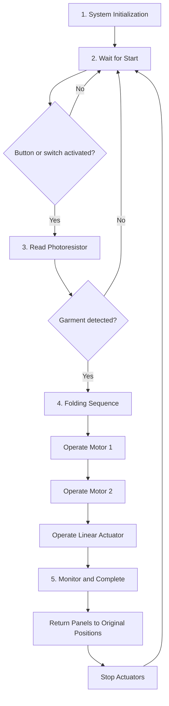

# Software Proposal

## Introduction

The EGR304 Team 209 project is an automated garment-folding device designed to reduce the time and effort required to fold clothing manually. The device consists of a stationary central platform and three movable folding panels. Two smaller panels are controlled by electric motors, while the longer panel is operated by a linear actuator.

The software will run on a PIC18F57Q43 Curiosity Nano microcontroller. The microcontroller will coordinate the motors, linear actuator, physical start control, photoresistor, and infrared (IR) sensor.

The central platform will contain a small opening for the photoresistor to detect garment presence. The IR sensor will be located along the fourth side of the platform, which does not have a folding panel. Its secondary control function will be finalized during software development.

The system is designed to operate automatically after the user initiates a folding cycle.

## Research Question

How can a PIC18F57Q43 microcontroller coordinate multiple folding mechanisms and sensor inputs to create an efficient, reliable, and user-friendly automated garment-folding device?

The software design focuses on:

1. Detecting a physical start command from a push button or switch.
2. Verifying garment presence using a photoresistor.
3. Controlling two motor-driven panels and one linear actuator.
4. Completing the folding sequence and returning the panels to their original positions.
5. Supporting an additional reset or repeat command through the IR sensor.

## Software Diagram

The following flowchart illustrates the proposed software sequence.

**Figure 1:** Proposed software flowchart for the automated garment-folding device. The order of individual folding panels may be adjusted during prototype testing.

## Software Design and Decision-Making Process

The software is organized into five main stages: system initialization, waiting for a start command, garment detection, folding sequence execution, and monitoring/completion.

**1. System Initialization**

When powered on, the PIC18F57Q43 initializes the input and output connections, sensor readings, and motor-control signals. The folding mechanisms remain inactive until the system receives a start command.

**2. Wait for Start**

The system waits for the user to activate a physical push button or switch. This approach was selected because it provides a simple user interface and prevents the folding sequence from starting solely because an object is placed on the platform.

**3. Detect Garment**

After receiving the start command, the microcontroller reads the photoresistor located beneath the central platform. The photoresistor measures changes in light intensity associated with garment placement.

If a garment is not detected, the software returns to the waiting state without activating the folding mechanisms. This decision reduces unnecessary operation and improves reliability.

**4. Folding Sequence**

After confirming garment presence, the microcontroller activates the folding mechanisms in a predetermined sequence.

The first motor operates one smaller folding panel, followed by the second motor operating the other smaller panel. The linear actuator then operates the longer folding panel.

Sequential movement was selected to simplify software control, reduce the possibility of mechanical interference, and improve folding consistency. The final panel order and timing will be verified during testing.

**5. Monitor and Complete**

The software manages the completion of each movement using the available motor-driver controls and the movement timing or feedback supported by the final hardware.

After the folding operation, the panels return to their original positions. The system then stops the actuators and returns to the waiting state, ready for another cycle.

The IR sensor is planned as an additional control input. The team will determine whether it is more practical to use this sensor for a reset or repeat command during implementation.

## How the Software Meets Product Requirements

| Product Requirement | Software Design Solution |
| --- | --- |
| Reduce manual folding effort | Automatically operates three folding panels after user initiation. |
| Improve folding consistency | Uses a programmed movement sequence for repeatable operation. |
| Ease of use | Requires a simple physical button or switch to begin operation. |
| Detect garment presence | Uses photoresistor readings before allowing the folding sequence. |
| Reliable operation | Returns to the waiting state when no garment is detected. |
| Repeatable operation | Returns all folding panels to their starting positions after completion. |
| Safe operation | Prevents movement before a start command and garment confirmation; additional safeguards will be evaluated during testing. |
| Reduce folding time by at least 40% | Automation is intended to reduce folding time; timed testing against manual folding will determine whether the target is achieved. |

## Hardware and Software Integration

The software will integrate the following hardware components:

1. **PIC18F57Q43 Curiosity Nano:** Main microcontroller responsible for executing the software.
2. **Two electric motors:** Operate the two smaller folding panels.
3. **Linear actuator:** Operates the longer folding panel.
4. **Photoresistor:** Detects garment presence through changes in light intensity.
5. **IR sensor:** Provides an additional input for a future reset or repeat function.
6. **Push button or switch:** Allows the user to initiate the folding sequence.
7. **Motor-driver circuitry:** Interfaces the microcontroller with the folding actuators.

The software will be developed using embedded C and MPLAB X IDE. The team will integrate the microcontroller program with the motor drivers, sensors, and mechanical folding panels as the prototype is assembled.

## Results

The software is currently in the proposal stage. The following are expected outcomes rather than experimentally verified results.

1. The system will wait for a physical start command before attempting a folding cycle.
2. The photoresistor will verify garment presence before the folding mechanisms activate.
3. The microcontroller will control the two motors and linear actuator in a programmed sequence.
4. The folding panels will return to their original positions after completing the operation.
5. The system will return to its waiting state for the next garment.

The team will evaluate folding time, consistency, sensor accuracy, and reliable operation during prototype testing.

## Conclusions and Future Work

The proposed software provides a structured approach for controlling the automated garment-folding device. By combining a physical start control, photoresistor detection, sequential motor operation, and automatic panel reset, the design aims to improve ease of use, consistency, and reliability.

Future work will include programming the PIC18F57Q43 using MPLAB X, calibrating the photoresistor, integrating the motor drivers, and testing the linear actuator and motor timing.

The team will also determine the final IR sensor function and verify that the system meets the target of reducing folding time by at least 40% compared with manual folding.

Additional testing will be necessary to evaluate safety, mechanical movement, sensor reliability, and overall folding performance.

## External Links

1. [PIC18F57Q43 Microcontroller](https://www.microchip.com/en-us/product/pic18f57q43) - Information about the microcontroller used to control the folding device.

2. [MPLAB X IDE](https://www.microchip.com/en-us/tools-resources/develop/mplab-x-ide) - Development environment used to write, compile, and debug the embedded C software.

3. [MPLAB Code Configurator (MCC) Melody](https://www.microchip.com/en-us/tools-resources/configure/mplab-code-configurator/melody) - Tool used to configure microcontroller peripherals, including analog inputs and digital outputs.

4. [Microchip Motor Control and Drive](https://www.microchip.com/en-us/solutions/technologies/motor-control-and-drive) - Technical resources related to motor control and driver operation.

5. [EGR304 Team 209 Project Website](https://asu-egr304-2026-f-209.github.io/ASU-EGR304-2026-F-209/) - Team documentation covering the garment-folding device design.

## References

1. Microchip Technology Inc. "PIC18F27/47/57Q43 Data Sheet." Technical documentation for the microcontroller, including GPIO, analog-to-digital conversion, and PWM peripherals. https://ww1.microchip.com/downloads/en/DeviceDoc/PIC18F27-47-57Q43-Data-Sheet-DS40002147E.pdf

2. Microchip Technology Inc. "MPLAB X Integrated Development Environment." Documentation for embedded software development, programming, and debugging. https://www.microchip.com/en-us/tools-resources/develop/mplab-x-ide

3. Microchip Technology Inc. "MPLAB Code Configurator (MCC) Melody." Documentation for configuring microcontroller peripherals and generating embedded software. https://www.microchip.com/en-us/tools-resources/configure/mplab-code-configurator/melody

4. Microchip Technology Inc. "Motor Control and Drive." Technical resources for motor-control systems. https://www.microchip.com/en-us/solutions/technologies/motor-control-and-drive

5. EGR304 Team 209. "Automated Garment-Folding Device Project Documentation." Arizona State University, Fall 2026. https://asu-egr304-2026-f-209.github.io/ASU-EGR304-2026-F-209/
